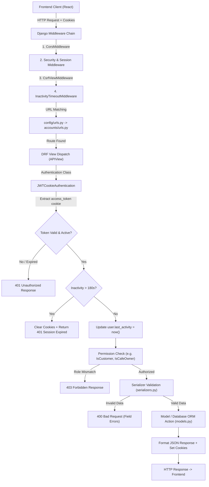
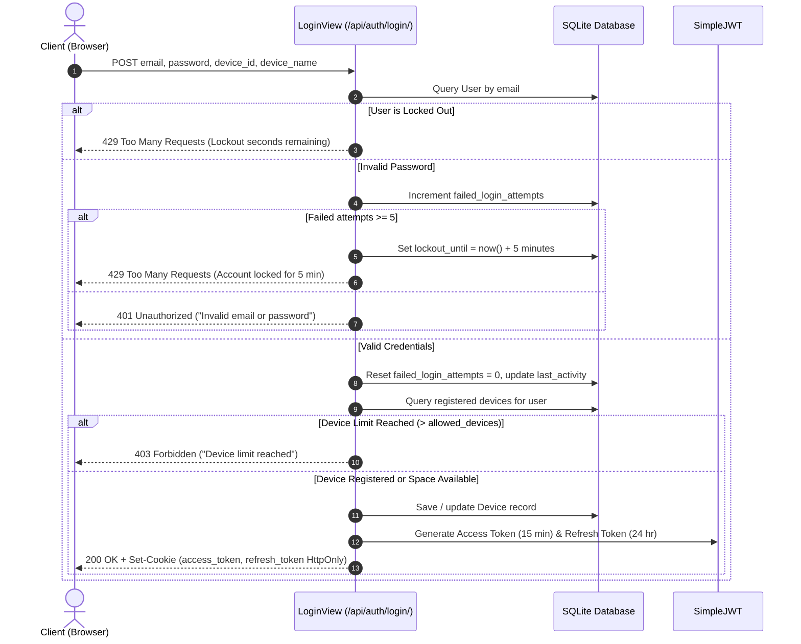
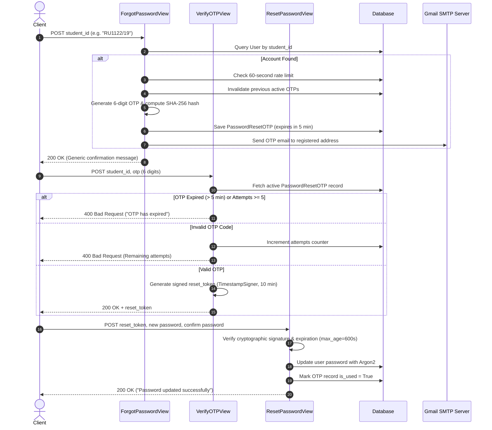
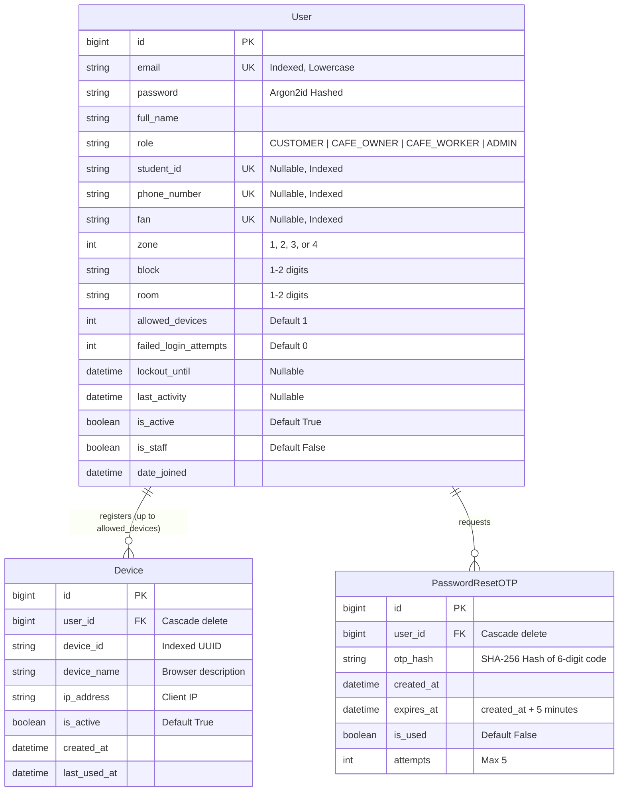

# University Café Pre-Order System — Backend Technical Architecture & Flow Documentation

This document provides a comprehensive, beginner-friendly technical guide to the Phase 1 backend architecture of the University Café Pre-Order System. It explains how each component is built, how data travels through the system, how security and authentication are enforced, and how to maintain and debug the codebase independently.

---

## 1. Backend Overview

### Responsibilities of the Backend
The backend serves as the authoritative, secure brain of the University Café Pre-Order System. In Phase 1, it handles:
- **Identity and Access Management:** User registration, credential verification, and role-based permissions.
- **Security Hardening:** Password complexity checks, Argon2 password hashing, brute-force rate-limiting, and 3-minute inactivity session expiration.
- **Device Management:** Tracking user devices and enforcing hardware limits per account.
- **Password Recovery:** Student ID verification, cryptographic One-Time Password (OTP) generation, and Gmail SMTP email dispatch.
- **Administration:** Django Admin portal integration for account oversight and device activation/revocation.
- **Phase Architecture Scaffolding:** Clean modular scaffolds for future Phase 2 domain logic (`cafes`, `students`, `system_admin`, `orders`, `transactions`).

### Technologies and Libraries Used
- **Python 3.12:** The core server programming language.
- **Django 6.0:** The primary web framework providing ORM, migrations, user management, and administration.
- **Django REST Framework (DRF) 3.15:** Toolkit for building RESTful APIs, serializers, and permission classes.
- **djangorestframework-simplejwt (with token blacklisting):** Generates and verifies HMAC-SHA256 JSON Web Tokens (JWT) stored in HttpOnly cookies.
- **argon2-cffi:** The password hashing library implementing Argon2id (memory-hard, resistant to GPU attacks).
- **django-cors-headers:** Handles Cross-Origin Resource Sharing (CORS) headers for communication with the Vite frontend.
- **python-dotenv:** Loads runtime environment variables from `backend/.env`.

### Communication with the Frontend
The frontend (React + Vite running at `http://localhost:5173`) communicates with the Django backend (`http://127.0.0.1:8000`) over HTTP using RESTful JSON endpoints.
- **Security Transport:** Authentication tokens are stored inside browser `HttpOnly`, `SameSite=Lax` cookies named `access_token` and `refresh_token`. JavaScript code cannot access these cookies, preventing Cross-Site Scripting (XSS) token theft.
- **CSRF Defense:** State-changing requests (`POST`, `PUT`, `DELETE`) pass Django's CSRF token via the `X-CSRFToken` request header.
- **Proxy Configuration:** In development, Vite forwards all `/api` requests to Django at `http://127.0.0.1:8000/api/`.

### Database Connection and Storage
- The project is configured with SQLite (`db.sqlite3`) as the default development database in `backend/config/settings.py`.
- Django's Object-Relational Mapping (ORM) abstracts all SQL queries. Switching to PostgreSQL or MySQL in production requires only modifying the `DATABASES` dictionary in `backend/config/settings.py` without rewriting application logic.

### Directory Structure
```
backend/
├── manage.py                          # Django CLI management entry point
├── db.sqlite3                         # Local SQLite database
├── .env                               # Private environment variables (git-ignored)
├── .env.example                       # Template for required environment variables
├── .gitignore                         # Git exclusion rules
├── config/                            # Project-level configuration directory
│   ├── __init__.py
│   ├── asgi.py                        # ASGI asynchronous deployment configuration
│   ├── wsgi.py                        # WSGI synchronous web server configuration
│   ├── urls.py                        # Root URL routing table
│   └── settings.py                    # Global application settings, installed apps, middleware
├── accounts/                          # Phase 1 Core Application: Authentication & Users
│   ├── __init__.py
│   ├── admin.py                       # Custom Django Admin panels for User, Device, OTP
│   ├── apps.py                        # Django AppConfig for accounts
│   ├── authentication.py              # JWTCookieAuthentication class
│   ├── middleware.py                  # InactivityTimeoutMiddleware (180s check)
│   ├── models.py                      # User, UserRole, Device, PasswordResetOTP models
│   ├── permissions.py                 # Role-based DRF permission classes
│   ├── serializers.py                 # Data validation and object serialization
│   ├── tests.py                       # 27 automated test cases for Phase 1
│   ├── urls.py                        # API route definitions for /api/auth/ and dashboards
│   ├── validators.py                  # Regex and complexity validators
│   ├── views.py                       # API endpoints and HTTP request handlers
│   ├── migrations/                    # Database migration history
│   │   ├── 0001_initial.py
│   │   └── __init__.py
│   └── management/
│       └── commands/
│           ├── __init__.py
│           └── seed_phase1_users.py   # Seeding script for test accounts across 4 roles
├── cafes/                             # Phase 1 Scaffold: Reserved for Cafe domain logic
│   ├── admin.py, apps.py, models.py, tests.py, views.py
├── students/                          # Phase 1 Scaffold: Reserved for Student domain logic
│   ├── admin.py, apps.py, models.py, tests.py, views.py
├── system_admin/                      # Phase 1 Scaffold: Reserved for Custom Admin logic
│   ├── admin.py, apps.py, models.py, tests.py, views.py
├── orders/                            # Phase 1 Scaffold: Reserved for Order domain logic
│   ├── admin.py, apps.py, models.py, tests.py, views.py
└── transactions/                      # Phase 1 Scaffold: Reserved for Payment domain logic
    ├── admin.py, apps.py, models.py, tests.py, views.py
```

---

## 2. Complete Backend Request Flow

Every HTTP request sent from the client traverses a defined pipeline in Django and Django REST Framework.



### Step-by-Step Flow Explanation

1. **Frontend Request:**
   The frontend initiates an HTTP call (e.g., `POST /api/auth/login/` or `GET /api/customer/dashboard/`) carrying request JSON and cookies (`credentials: 'include'`).
2. **CORS Handling (`corsheaders.middleware.CorsMiddleware`):**
   Verifies that the origin (`http://localhost:5173`) is in `CORS_ALLOWED_ORIGINS`. If preflight `OPTIONS` arrives, returns approved HTTP headers.
3. **Security and CSRF (`CsrfViewMiddleware`):**
   For state-changing actions (`POST`, `PUT`, `DELETE`), ensures the request carries an authentic `X-CSRFToken` header matching Django's session/cookie token.
4. **Inactivity Middleware (`accounts.middleware.InactivityTimeoutMiddleware`):**
   Runs globally before views. For non-exempt routes, checks if a session has exceeded `INACTIVITY_TIMEOUT_SECONDS` (180 seconds). If expired, cookies are erased and HTTP 401 is returned.
5. **URL Routing (`config.urls` -> `accounts.urls`):**
   Resolves the URL path to the corresponding DRF `APIView` class (e.g., `path('auth/login/', LoginView.as_view())`).
6. **Authentication (`accounts.authentication.JWTCookieAuthentication`):**
   Before reaching the view method, DRF runs authentication. `JWTCookieAuthentication` reads the `access_token` cookie, validates the cryptographic signature, looks up the active `User`, and verifies that `last_activity` is within 180 seconds.
7. **Permission Enforcement (`accounts.permissions.*`):**
   DRF executes `permission_classes`. If a Customer tries to access `/api/cafe-owner/dashboard/`, `IsCafeOwner.has_permission()` returns `False`, terminating the request with HTTP 403 Forbidden.
8. **Serializer and Data Validation (`accounts.serializers.*`):**
   If the view receives request data, the serializer validates every field using custom regex and similarity checks. If validation fails, DRF halts execution and returns HTTP 400 Bad Request with field-specific error messages.
9. **Model and Database ORM (`accounts.models.*`):**
   The validated data is committed to `db.sqlite3` via Django ORM methods (such as `user.set_password()` or `Device.objects.create()`).
10. **Response Formulation and Cookies:**
    The view wraps the response data in a `rest_framework.response.Response`. For authentication views, `set_auth_cookies()` attaches the HttpOnly `access_token` and `refresh_token` before returning HTTP 200 or 201 to the client.

---

## 3. Django Project Configuration Files

### `manage.py`
- **What it is:** The command-line management script for this Django project.
- **Why it exists:** Provides the entry point for starting development servers, creating migrations, running unit tests, and executing custom commands.
- **Important logic:** Points the environment variable `DJANGO_SETTINGS_MODULE` to `config.settings`.
- **When to edit:** Developers rarely edit this file directly.
- **Troubleshooting:** If running commands fails with `ImportError: Couldn't import Django`, verify that your virtual environment is active.

### `config/settings.py`
- **What it is:** The central settings configuration for the entire backend.
- **Why it exists:** Configures database connections, registered applications, security headers, password hashing algorithms, CORS origins, JWT lifetimes, and SMTP email parameters.
- **Important configuration sections:**
  - `INSTALLED_APPS`: Registers third-party libraries (`corsheaders`, `rest_framework`, `rest_framework_simplejwt.token_blacklist`) and internal apps (`accounts`, `cafes`, `students`, `system_admin`, `orders`, `transactions`).
  - `AUTH_USER_MODEL = 'accounts.User'`: Replaces default Django User with custom `accounts.User`.
  - `PASSWORD_HASHERS`: Configures `Argon2PasswordHasher` as primary hasher ahead of PBKDF2.
  - `REST_FRAMEWORK`: Sets default authentication class to `JWTCookieAuthentication`.
  - `INACTIVITY_TIMEOUT_SECONDS = 180`: Sets the 3-minute session expiration window.
  - `MAX_FAILED_LOGIN_ATTEMPTS = 5` and `LOGIN_LOCKOUT_MINUTES = 5`: Configures brute-force lockout.
  - `EMAIL_*`: Gmail SMTP configuration loaded from environment variables.
- **When to edit:** When changing database credentials, modifying session timeouts, adjusting lockout parameters, or adding new apps.
- **Troubleshooting:** Check this file if CORS errors occur, tokens expire at unexpected intervals, or email settings fail to load.

### `config/urls.py`
- **What it is:** The top-level URL routing configuration.
- **Why it exists:** Maps incoming HTTP request prefixes to specific application URL modules.
- **Important logic:**
  - `path('admin/', admin.site.urls)`: Connects Django Admin.
  - `path('api/', include('accounts.urls'))`: Routes all `/api/...` calls into `accounts.urls`.
- **When to edit:** When exposing a new top-level API section (for example, `/api/cafes/` in Phase 2).
- **Troubleshooting:** If API requests return HTTP 404, verify the prefix mapping in this file.

### `config/asgi.py` and `config/wsgi.py`
- **What they are:** Asynchronous (ASGI) and Synchronous (WSGI) deployment entry points.
- **Why they exist:** Enable production web servers (e.g., Gunicorn, Uvicorn, Daphne) to serve the Django application.
- **When to edit:** Only during production deployment configuration (e.g., setting up WebSockets or reverse proxies).

### `backend/.env` and `backend/.env.example`
- **What they are:** The local environment variable files.
- **Why they exist:** Keep sensitive credentials (such as `SECRET_KEY` and `EMAIL_HOST_PASSWORD`) out of git version control.
- **Important contents:**
  ```env
  DEBUG=True
  SECRET_KEY=django-insecure-university-cafe-secret-key-phase1-dev-2026
  ALLOWED_HOSTS=localhost,127.0.0.1
  EMAIL_BACKEND=django.core.mail.backends.smtp.EmailBackend
  EMAIL_HOST=smtp.gmail.com
  EMAIL_PORT=587
  EMAIL_USE_TLS=True
  EMAIL_HOST_USER=amukaseid18@gmail.com
  EMAIL_HOST_PASSWORD=PASTE_YOUR_GMAIL_APP_PASSWORD_HERE
  DEFAULT_FROM_EMAIL=amukaseid18@gmail.com
  ```
- **When to edit:** When updating your 16-character Gmail App Password or changing production hostnames.

---

## 4. Detailed Explanation of Every App

### App 1: `accounts` (Phase 1 Core Application)
The `accounts` app contains all user management, authentication, role access control, device tracking, and password reset logic.

#### `accounts/models.py`
- **Purpose:** Defines database tables and schemas for users, roles, devices, and OTPs.
- **Classes Defined:**
  1. `UserRole(models.TextChoices)`: Defines the four immutable roles: `CUSTOMER`, `CAFE_OWNER`, `CAFE_WORKER`, `ADMIN`.
  2. `CustomUserManager(BaseUserManager)`: Custom manager overriding user creation. Normalizes emails to lowercase, sets default role to `CUSTOMER`, and configures `create_superuser` with `ADMIN` role.
  3. `User(AbstractBaseUser, PermissionsMixin)`: Custom user model storing email, full name, role, customer profile fields (`student_id`, `phone_number`, `fan`, `zone`, `block`, `room`), and security state (`allowed_devices`, `failed_login_attempts`, `lockout_until`, `last_activity`). Includes helper methods `is_locked_out` and `remaining_lockout_seconds()`.
  4. `Device(models.Model)`: Stores registered devices per user with `device_id`, `device_name`, `ip_address`, `is_active`, `created_at`, and `last_used_at`. Uses `unique_together = ('user', 'device_id')`.
  5. `PasswordResetOTP(models.Model)`: Stores SHA-256 hashed OTPs with foreign key to `User`, `expires_at` (5 minutes from creation), `is_used` boolean flag, and `attempts` counter. Methods include `hash_otp()`, `check_otp()`, and properties `is_expired` and `is_valid`.
- **When to check:** When adding profile fields, altering device constraints, or modifying OTP expiration rules.

#### `accounts/views.py`
- **Purpose:** Contains all REST API endpoints.
- **Classes and Functions Defined:**
  1. `get_client_ip(request)`: Helper extracting the client IP address from `HTTP_X_FORWARDED_FOR` or `REMOTE_ADDR`.
  2. `set_auth_cookies(response, access_token, refresh_token)`: Sets secure `HttpOnly`, `SameSite=Lax` cookies on outgoing responses.
  3. `CSRFTokenView(APIView)`: `GET /api/auth/csrf/` generates and returns a fresh CSRF token.
  4. `RegisterView(APIView)`: `POST /api/auth/register/` handles public registration. Validates input through `CustomerRegistrationSerializer` and creates `CUSTOMER` accounts.
  5. `LoginView(APIView)`: `POST /api/auth/login/` validates credentials, enforces brute-force lockout (5 attempts / 5 minutes), enforces device limits, registers devices, resets failed counters, creates JWT tokens, and sets cookies.
  6. `LogoutView(APIView)`: `POST /api/auth/logout/` clears `last_activity`, blacklists the refresh token, and deletes authentication cookies.
  7. `CurrentUserView(APIView)`: `GET /api/auth/me/` returns serialized data for the currently authenticated user.
  8. `RefreshTokenView(APIView)`: `POST /api/auth/refresh/` validates the refresh token cookie, enforces 180s inactivity timeout, blacklists old refresh token, issues new tokens, and updates cookies.
  9. `ForgotPasswordView(APIView)`: `POST /api/auth/forgot-password/` looks up user by `student_id`, enforces 60-second rate-limiting, checks SMTP credentials, generates a 6-digit random OTP, hashes it, saves it to `PasswordResetOTP`, and sends both plain-text and HTML emails via Gmail SMTP.
  10. `VerifyOTPView(APIView)`: `POST /api/auth/verify-otp/` verifies the 6-digit code against the SHA-256 hash, enforces a maximum of 5 attempts and a 5-minute expiry, and returns a signed cryptographic `reset_token` (valid for 10 minutes) generated by `TimestampSigner`.
  11. `ResetPasswordView(APIView)`: `POST /api/auth/reset-password/` verifies the `reset_token`, validates password complexity, updates password using Argon2, resets lockout counters, and marks the OTP record as used.
  12. `CustomerDashboardView`, `CafeOwnerDashboardView`, `CafeWorkerDashboardView`, `AdminDashboardView`: Role-protected endpoints returning status confirmations for each role.

#### `accounts/serializers.py`
- **Purpose:** Validates incoming JSON and formats outgoing model instances.
- **Classes Defined:**
  1. `CustomerRegistrationSerializer`: Validates all required student fields (`full_name`, `student_id`, `email`, `phone_number`, `fan`, `zone`, `block`, `room`, `password`, `confirm_password`). Enforces personal information similarity checks (rejects passwords containing student ID, phone, FAN, or email username). Strictly forces `role = CUSTOMER` in the `create()` method.
  2. `UserSerializer`: Safe read-only serializer outputting public profile fields.
  3. `LoginSerializer`: Validates `email`, `password`, `device_id`, and optional `device_name`.
  4. `ForgotPasswordSerializer`: Validates `student_id` using format `^[Rr][Uu]\d{4}/\d{2}$`.
  5. `VerifyOTPSerializer`: Validates 6-digit OTP code along with `student_id` or `email`.
  6. `ResetPasswordSerializer`: Validates `reset_token`, password confirmation match, and password complexity.

#### `accounts/validators.py`
- **Purpose:** Reusable validation logic and regex patterns.
- **Validators Defined:**
  1. `ComplexPasswordValidator`: Validates passwords for minimum 9 characters, at least 1 uppercase, 1 lowercase, 1 digit, and 1 special character.
  2. `validate_student_id(value)`: Enforces regex `^[Rr][Uu]\d{4}/\d{2}$` (e.g., `RU0101/16` or `ru1122/19`).
  3. `validate_gmail(value)`: Rejects non-Gmail addresses (`.endswith('@gmail.com')`).
  4. `validate_phone_number(value)`: Enforces 10 digits starting with `09` or `07` (`^(09|07)\d{8}$`).
  5. `validate_fan(value)`: Enforces numeric-only strings (`^\d+$`).
  6. `validate_block_or_room(value, field_name)`: Enforces 1-2 digit numeric values (`^\d{1,2}$`).

#### `accounts/middleware.py`
- **Purpose:** Global request interceptor for inactivity timeout.
- **Class:** `InactivityTimeoutMiddleware` checks `request.user.last_activity` against `INACTIVITY_TIMEOUT_SECONDS` (180s) for non-exempt endpoints. If exceeded, it clears `last_activity`, deletes auth cookies, and returns HTTP 401 with code `session_expired`.

#### `accounts/authentication.py`
- **Purpose:** Custom DRF authentication backend.
- **Class:** `JWTCookieAuthentication` extracts the JWT access token from the `access_token` cookie first (falling back to the `Authorization: Bearer <token>` header). Validates token signature, retrieves the user, checks if `is_active` is True, verifies the 180s inactivity window, and updates `last_activity` to the current time.

#### `accounts/permissions.py`
- **Purpose:** DRF authorization guards for API views.
- **Classes:**
  1. `IsCustomer`: Requires `user.is_authenticated` and `user.role == UserRole.CUSTOMER`.
  2. `IsCafeOwner`: Requires `user.is_authenticated` and `user.role == UserRole.CAFE_OWNER`.
  3. `IsCafeWorker`: Requires `user.is_authenticated` and `user.role == UserRole.CAFE_WORKER`.
  4. `IsSystemAdmin`: Requires `user.is_authenticated` and `user.role == UserRole.ADMIN`.

#### `accounts/admin.py`
- **Purpose:** Configures the Django Admin portal (`/admin/`).
- **Features:**
  - `CustomUserAdmin`: Displays email, full name, role, device limits, lockout status, and activity dates. Allows administrators to change roles, adjust `allowed_devices`, unlock locked accounts, and filter by role or zone.
  - `DeviceAdmin`: Displays user devices, IP addresses, and activity timestamps. Includes bulk actions to activate or revoke devices.
  - `PasswordResetOTPAdmin`: Read-only view for auditing OTP attempts, expiration times, and usage flags.

#### `accounts/management/commands/seed_phase1_users.py`
- **Purpose:** Management command (`python manage.py seed_phase1_users`) to populate initial accounts for testing:
  - Admin: `admin@gmail.com` / `AdminPassword123!`
  - Café Owner: `owner@gmail.com` / `OwnerPassword123!`
  - Café Worker: `worker@gmail.com` / `WorkerPassword123!`
  - Customer: `customer@gmail.com` / `CustomerPassword123!`

#### `accounts/tests.py`
- **Purpose:** Automated test suite containing 27 unit tests verifying:
  - Password complexity and similarity rules.
  - Case-insensitive Student ID validation (`ru0101/16` and `RU0101/16`).
  - Gmail-only email enforcement.
  - Public registration assigning `CUSTOMER` role exclusively.
  - Argon2 password hashing.
  - Brute-force lockout after 5 failed attempts.
  - Device limits and revocation.
  - Role permissions and dashboard protection.
  - 3-minute inactivity expiration.
  - Forgot password Student ID lookup, OTP hashing, and 5-minute expiration.

### Apps 2–6: Modular Scaffold Applications
To maintain clean separation of concerns, Phase 1 creates five scaffold applications registered in `INSTALLED_APPS`. In Phase 1, their models and views remain empty skeletons reserved for future implementation:
1. `cafes/`: Reserved for café entity profiles, operating hours, and menu management.
2. `students/`: Reserved for student-specific preferences and meal vouchers.
3. `system_admin/`: Reserved for platform analytics and café verification workflows.
4. `orders/`: Reserved for pre-order placement, queueing, and pickup tracking.
5. `transactions/`: Reserved for payment gateways and student balance ledgers.

---

## 5. Authentication and Security Flow

### Registration Flow
1. Public client sends `POST /api/auth/register/` with personal details and passwords.
2. `CustomerRegistrationSerializer` validates field regexes, uniqueness, and password complexity.
3. Personal similarity checks prevent using student ID, phone number, FAN, or email in the password.
4. The serializer explicitly forces `role = UserRole.CUSTOMER` and `allowed_devices = 1`. Any client-supplied role is discarded.
5. `User.objects.create_user()` invokes Django's password hasher, which encodes the password using **Argon2id**.
6. The user record is saved to `db.sqlite3` with `is_active = True`.

### Login Flow



### Inactivity Timeout Enforcement
- The backend enforces a strict 3-minute (180 seconds) inactivity limit.
- Every authenticated request processed by `JWTCookieAuthentication` compares `timezone.now() - user.last_activity`.
- If the elapsed time exceeds 180 seconds, the backend erases `user.last_activity`, clears the cookies, and returns HTTP 401 with error code `session_expired`.
- If the elapsed time is within 180 seconds, `user.last_activity` is updated to `timezone.now()`.

### Forgot Password Flow



---

## 6. Database Schema and Relationships

Phase 1 establishes three relational models in the `accounts` application.



---

## 7. API Endpoint Reference

| Method | Endpoint URL | Purpose | Authentication | Permission | Request Body / Params | Expected Response |
| :--- | :--- | :--- | :--- | :--- | :--- | :--- |
| `GET` | `/api/auth/csrf/` | Retrieve a fresh CSRF token | None | `AllowAny` | None | `{"csrfToken": "<token>"}` |
| `POST` | `/api/auth/register/` | Public student registration | None | `AllowAny` | `full_name`, `student_id`, `email`, `phone_number`, `fan`, `zone`, `block`, `room`, `password`, `confirm_password` | `201 Created` with created user details |
| `POST` | `/api/auth/login/` | Authenticate user and issue cookies | None | `AllowAny` | `email`, `password`, `device_id`, optional `device_name` | `200 OK` + `Set-Cookie` for tokens |
| `POST` | `/api/auth/logout/` | Sign out and invalidate session | None | `AllowAny` | Cookies | `200 OK` + deletes cookies |
| `GET` | `/api/auth/me/` | Fetch current profile | Cookie / Bearer | `IsAuthenticated` | None | `200 OK` with user profile |
| `POST` | `/api/auth/refresh/` | Rotate access and refresh tokens | Refresh Cookie | `AllowAny` | Refresh token cookie | `200 OK` + updated cookies |
| `POST` | `/api/auth/forgot-password/` | Request OTP to registered email | None | `AllowAny` | `{"student_id": "RU1122/19"}` | `200 OK` with generic confirmation |
| `POST` | `/api/auth/verify-otp/` | Verify 6-digit OTP code | None | `AllowAny` | `{"student_id": "...", "otp": "123456"}` | `200 OK` + `{"reset_token": "..."}` |
| `POST` | `/api/auth/reset-password/` | Set new password with reset token | None | `AllowAny` | `reset_token`, `password`, `confirm_password` | `200 OK` confirmation |
| `GET` | `/api/customer/dashboard/` | Customer role dashboard verification | Cookie / Bearer | `IsCustomer` | None | `200 OK` with customer greeting |
| `GET` | `/api/cafe-owner/dashboard/` | Café Owner dashboard verification | Cookie / Bearer | `IsCafeOwner` | None | `200 OK` with owner greeting |
| `GET` | `/api/cafe-worker/dashboard/` | Café Worker dashboard verification | Cookie / Bearer | `IsCafeWorker` | None | `200 OK` with worker greeting |
| `GET` | `/api/admin/dashboard/` | System Admin dashboard verification | Cookie / Bearer | `IsSystemAdmin` | None | `200 OK` with admin greeting |

---

## 8. Troubleshooting Guide

| Problem | First file to check | What to inspect |
| :--- | :--- | :--- |
| Registration fails with field errors | `accounts/serializers.py` | Inspect `CustomerRegistrationSerializer.validate_*` methods for regex and uniqueness constraints. |
| Password rejected during registration | `accounts/validators.py` | Inspect `ComplexPasswordValidator` rules (must be at least 9 chars, with uppercase, lowercase, digit, and special char). |
| Login rejected with "Invalid email or password" | `accounts/views.py` (`LoginView`) | Inspect line 121 where `user.check_password()` verifies the Argon2 hash. |
| Account locked out (HTTP 429) | `accounts/models.py` & Django Admin | Inspect `user.lockout_until` and `user.failed_login_attempts`. Reset them via Django Admin. |
| Login rejected with "Device limit reached" | `accounts/views.py` (`LoginView`) | Inspect `active_count >= user.allowed_devices`. Manage registered devices in Django Admin (`DeviceAdmin`). |
| OTP email is not delivered | `backend/.env` & `accounts/views.py` | Inspect `EMAIL_HOST_PASSWORD` in `backend/.env`. Ensure a 16-character Gmail App Password is configured. |
| Gmail SMTP authentication failed (HTTP 503) | `backend/.env` | Verify that 2-Step Verification is enabled on the Gmail account and the generated App Password has no spaces. |
| OTP rejected as expired | `accounts/models.py` (`PasswordResetOTP`) | Check `expires_at` (5-minute limit) and `attempts` counter (maximum 5 attempts). |
| Session expires after 3 minutes | `accounts/authentication.py` & `middleware.py` | Check `INACTIVITY_TIMEOUT_SECONDS` (180s) and verify client sends activity events. |
| Role permissions return 403 Forbidden | `accounts/permissions.py` | Check `request.user.role` against `UserRole` enum values. |
| Database migration error | `accounts/models.py` & `accounts/migrations/` | Check model field definitions and run `python manage.py makemigrations`. |

---

## 9. How to Maintain the Backend

### Changing Registration Fields or Rules
1. Update `User` model in `accounts/models.py` if adding or removing database columns.
2. Run `python manage.py makemigrations accounts` and `python manage.py migrate`.
3. Update `CustomerRegistrationSerializer` in `accounts/serializers.py` to add validation logic.
4. Update `accounts/validators.py` if new regex checks are required.

### Modifying Password Complexity Rules
1. Open `accounts/validators.py` and modify `ComplexPasswordValidator.validate()`.
2. Update the helper text in `ComplexPasswordValidator.get_help_text()`.
3. Run `python manage.py test accounts` to verify that existing test suites pass.

### Modifying Session Inactivity Timeout
1. Open `backend/config/settings.py` and locate `INACTIVITY_TIMEOUT_SECONDS = 180`.
2. Change the duration in seconds (e.g., `300` for 5 minutes).
3. Update the matching frontend timer constant `INACTIVITY_TIMEOUT_MS` in `frontend/src/context/AuthContext.tsx`.

### Adding a New User Role
1. Add the role to `UserRole` in `accounts/models.py`.
2. Create a new permission class in `accounts/permissions.py` (e.g., `IsAuditor`).
3. Create corresponding protected views and map them in `accounts/urls.py`.
4. Run migrations if the model choice field was modified.

---

## 10. Backend Summary

The Phase 1 backend operates as an isolated, secure API engine. Every client request enters through Django's middleware chain, is screened by `CorsMiddleware` and `InactivityTimeoutMiddleware`, and is routed to DRF views. `JWTCookieAuthentication` verifies credentials stored in secure HttpOnly cookies, rejecting inactive sessions after 180 seconds. Protected views enforce role checks via permission classes before data hits serializers and models. All passwords are encrypted with Argon2id, accounts are guarded against brute-force attacks by automatic lockouts, and password resets are verified using Student IDs and Gmail SMTP OTP codes. Clean scaffold apps stand ready for Phase 2 expansion.
