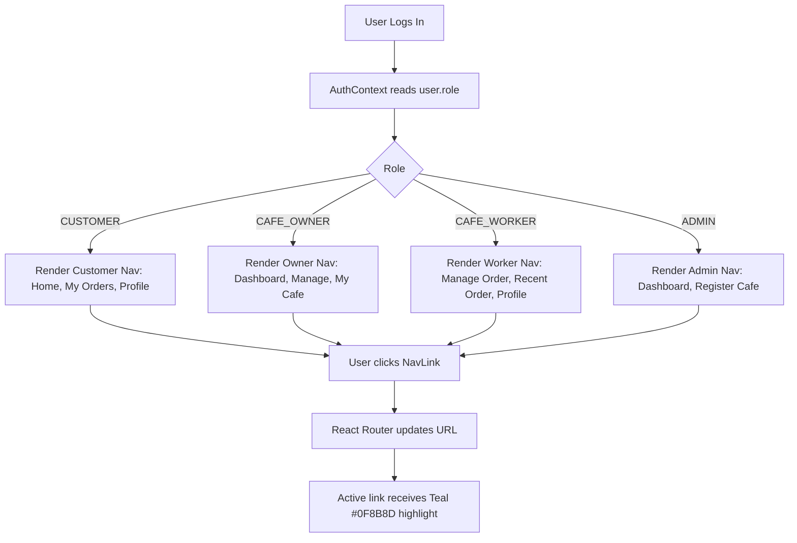

# University Café Pre-Order System — Frontend Technical Architecture & Flow Documentation

This document provides a comprehensive, beginner-friendly technical guide to the Phase 1 frontend architecture of the University Café Pre-Order System. It explains how React, TypeScript, and Tailwind CSS work together, where every page and component is located, how authentication and role-based routing operate, and how to maintain and customize the user interface independently.

---

## 1. Frontend Overview

### Technologies Used
- **React 19:** Modern JavaScript library for building component-based declarative user interfaces.
- **TypeScript 5.9:** Statically typed superset of JavaScript that prevents runtime type errors and documents data models through explicit interfaces.
- **Vite 6:** Fast frontend build tool and local development server with Hot Module Replacement (HMR).
- **Tailwind CSS v4 (`@tailwindcss/vite`):** Utility-first CSS framework configured with custom CSS theme variables for brand identity.
- **React Router DOM v7:** Client-side routing library handling multi-page navigation without full browser reloads.
- **Lucide React:** Icon library providing clean, professional vector icons.

### Communication with the Django Backend
- **Base Transport:** The frontend sends asynchronous JSON requests using the native browser `fetch` API wrapped in `src/services/api.ts`.
- **Development Proxy:** Configured in `vite.config.ts`, Vite proxies `/api` calls directly to Django at `http://127.0.0.1:8000/api/`. This avoids cross-origin browser restrictions in development.
- **Cookie-Based Authentication:** Tokens are never stored in localStorage or JavaScript memory where they could be stolen by malicious scripts. Instead, the backend sets `HttpOnly` cookies, which the browser automatically transmits with every request using `credentials: 'include'`.
- **CSRF Protection:** Before state-changing requests (`POST`, `PUT`, `DELETE`), `src/services/api.ts` fetches or extracts the CSRF token and sets the `X-CSRFToken` HTTP header.

### Directory Structure
```
frontend/
├── index.html                         # Single-page HTML host document
├── package.json                       # Dependencies, scripts (dev, build, test)
├── tsconfig.json                      # Master TypeScript compiler configuration
├── tsconfig.app.json                  # Application TypeScript compiler settings
├── vite.config.ts                     # Vite build, plugins, and proxy configuration
├── public/                            # Static assets served as-is
└── src/
    ├── main.tsx                       # React application bootstrapper (createRoot)
    ├── App.tsx                        # Master router, route definitions, root redirect
    ├── App.css                        # App-level styling rules
    ├── index.css                      # Global Tailwind theme variables and typography
    ├── types/
    │   └── auth.ts                    # TypeScript types (User, UserRole, AuthState)
    ├── services/
    │   └── api.ts                     # API client wrapper, CSRF token, device UUID
    ├── context/
    │   └── AuthContext.tsx            # Global auth state, session check, 3-min inactivity
    ├── components/
    │   ├── DashboardLayout.tsx        # Responsive layout shell with sidebar and header
    │   ├── Sidebar.tsx                # Role-specific navigation sidebar and user drawer
    │   ├── ProtectedRoute.tsx         # Route authorization guard checking user roles
    │   ├── Phase1Modal.tsx            # Dismissible Phase 1 completion modal popup
    │   ├── Phase1PlaceholderCard.tsx  # Simplified 3-line card for dashboard views
    │   ├── TypographicLogo.tsx        # System branding logo in official palette
    │   └── PasswordRequirements.tsx   # Live password strength indicator checklist
    ├── pages/
    │   ├── auth/
    │   │   ├── LoginPage.tsx          # Login form with device ID tracking & lockout alerts
    │   │   ├── RegisterPage.tsx       # Student registration form with live validations
    │   │   └── ForgotPasswordPage.tsx # 3-step password recovery (Student ID, OTP, Reset)
    │   ├── customer/
    │   │   ├── CustomerHomePage.tsx   # Customer "Home" view
    │   │   ├── CustomerOrdersPage.tsx # Customer "My Orders" view
    │   │   └── CustomerProfilePage.tsx# Customer "Profile" view
    │   ├── owner/
    │   │   ├── OwnerDashboardPage.tsx # Café Owner "Dashboard" view
    │   │   ├── OwnerManagePage.tsx    # Café Owner "Manage" view
    │   │   └── OwnerCafePage.tsx      # Café Owner "My Cafe" view
    │   ├── worker/
    │   │   ├── WorkerOrdersPage.tsx   # Café Worker "Manage Order" view
    │   │   ├── WorkerRecentPage.tsx   # Café Worker "Recent Order" view
    │   │   └── WorkerProfilePage.tsx  # Café Worker "Profile" view
    │   └── admin/
    │       ├── AdminDashboardPage.tsx # System Admin "Dashboard" view
    │       └── AdminRegisterCafePage.tsx # System Admin "Register Cafe" view
    └── tests/
        └── auth.test.ts               # Automated Node.js tests for auth & validation rules
```

---

## 2. Complete Frontend Application Flow

```mermaid
flowchart TD
    A["Browser Loads index.html"] --> B["main.tsx (createRoot)"]
    B --> C["AuthProvider (src/context/AuthContext.tsx)"]
    C --> D["Runs checkAuth() -> GET /api/auth/me/"]
    D --> E["BrowserRouter & Routes (src/App.tsx)"]
    E --> F{"Route Path"}
    F -->|"/login, /register, /forgot-password"| G["Render Auth Page"]
    F -->|"/" (RootRedirect)| H{"Is Authenticated?"}
    H -->|"No"| I["Navigate to /login"]
    H -->|"Yes"| J["Navigate to Role Dashboard Path via getDashboardPath()"]
    F -->|"Role Protected Path (e.g. /customer/home)"| K["ProtectedRoute Guard"]
    K -->|"Session Loading"| L["Show Spinner"]
    K -->|"Not Authenticated"| I
    K -->|"Role Unauthorized"| M["Redirect to Allowed Role Dashboard"]
    K -->|"Authorized"| N["Render DashboardLayout"]
    N --> O["Mount Sidebar + Inactivity Header + Page View"]
    N --> P["Display Phase1Modal (Once per session)"]
```

### Application Initialization Step-by-Step

1. **Mounting:** When the browser visits `http://localhost:5173/`, `index.html` loads and executes `src/main.tsx`.
2. **Context Setup:** `main.tsx` mounts `<App />`, which initializes `<AuthProvider>`.
3. **Session Check (`checkAuth()`):**
   - Retrieves or creates a persistent device UUID in `localStorage` via `getOrCreateDeviceId()`.
   - Sends a background request to `/api/auth/me/` with HttpOnly cookies.
   - If the backend returns `200 OK` with user data, `user` is set in React state.
   - If the request returns `401 Unauthorized`, `user` is set to `null` and `isLoading` becomes `false`.
4. **Routing Evaluation (`App.tsx`):**
   - The user is evaluated by `<RootRedirect />`.
   - If not authenticated, the user is redirected to `/login`.
   - If authenticated, `getDashboardPath(user.role)` automatically navigates the user to their designated dashboard:
     - `CUSTOMER` → `/customer/home`
     - `CAFE_OWNER` → `/owner/dashboard`
     - `CAFE_WORKER` → `/worker/orders`
     - `ADMIN` → `/admin/dashboard`
5. **Route Guarding (`ProtectedRoute.tsx`):**
   - Verifies whether the active user's role is present in `allowedRoles`.
   - If an unauthorized user attempts to enter an unpermitted URL manually, `ProtectedRoute` intercepts the attempt and redirects them back to their own dashboard.
6. **Layout and View Assembly (`DashboardLayout.tsx`):**
   - Renders the unified Navy Blue `#16324F` `Sidebar` with role-specific menu items.
   - Injects the dismissible `Phase1Modal` completion dialog (shown once per session).
   - Renders the page view inside the Warm White `#F7F5EF` canvas.

---

## 3. Important Frontend Files

### `src/main.tsx`
- **What it does:** The TypeScript entry point for the React application.
- **Logic:** Imports global styles (`index.css`), selects the DOM element `#root`, and renders `<App />` inside React's `<StrictMode>`.
- **When to edit:** Rarely. Only needed if adding a top-level provider or error boundary.

### `src/App.tsx`
- **What it does:** The central router configuration of the application.
- **Logic:** Declares all public and protected URL routes, connects `<AuthProvider>`, and defines `<RootRedirect>` for role-based entry redirection.
- **Files using it:** `main.tsx`.
- **When to edit:** When adding new pages, renaming URL routes, or changing role permissions.

### `vite.config.ts`
- **What it does:** Configures the Vite development server and build engine.
- **Logic:** Injects `@vitejs/plugin-react` and `@tailwindcss/vite`. Proxies `/api` requests to `http://127.0.0.1:8000`.
- **When to edit:** If changing the backend API port or adding build optimization plugins.

### `src/index.css`
- **What it does:** Defines global typography, base styles, and the four official system colors using Tailwind CSS `@theme` variables:
  ```css
  @theme {
    --color-primary-navy: #16324F;
    --color-secondary-teal: #0F8B8D;
    --color-accent-amber: #F4A261;
    --color-warm-white: #F7F5EF;
  }
  ```
- **When to edit:** To change global background tones, brand palette hex codes, or font families.

### `src/services/api.ts`
- **What it does:** The core HTTP communication client.
- **Key functions:**
  - `getOrCreateDeviceId()`: Generates a persistent browser UUID using `crypto.randomUUID()` and caches it in `localStorage.getItem('cafe_device_id')`.
  - `fetchCsrfToken()`: Reads `csrftoken` from `document.cookie` or calls `/api/auth/csrf/`.
  - `apiRequest<T>(endpoint, options)`: Wrapper around `fetch` that automatically injects `Content-Type: application/json`, `X-CSRFToken` for write operations, and `credentials: 'include'`. If an endpoint returns HTTP 401, it attempts one token refresh via `/api/auth/refresh/` before rejecting.
- **When to edit:** When adjusting network headers, error handling formats, or token refresh logic.

### `src/context/AuthContext.tsx`
- **What it does:** Global state store providing authentication status and user information across all components.
- **Key logic:**
  - `user`: Holds the authenticated `User` object or `null`.
  - `login(userData)`: Updates user state upon successful login.
  - `logout()`: Clears local state, calls `/api/auth/logout/`, and resets timers.
  - **3-Minute Inactivity Timer:** Implements a strict 180,000 ms timer (`INACTIVITY_TIMEOUT_MS = 3 * 60 * 1000`). Listens to `mousemove`, `keydown`, `mousedown`, `touchstart`, and `scroll`. Resets the countdown on activity; if 3 minutes pass without interaction, it invokes `logout(true)` and displays a session expiration notice.
  - `getDashboardPath(role)`: Maps roles to default home paths.
- **When to edit:** To alter inactivity timeout duration or user session properties.

### `src/components/ProtectedRoute.tsx`
- **What it does:** A higher-order component that wraps route elements to prevent unauthorized access.
- **Logic:**
  - If authentication is still loading, renders a loading spinner.
  - If not authenticated, redirects to `/login`.
  - If `allowedRoles` does not contain `user.role`, redirects to the user's authorized home dashboard.
- **When to edit:** To adjust route protection behaviors.

### `src/components/Sidebar.tsx`
- **What it does:** Renders the persistent navigation sidebar.
- **Logic:**
  - Uses the official Navy Blue `#16324F` surface with clean white text.
  - Injects role-specific navigation items from `roleNavItems`:
    - Customer: `Home`, `My Orders`, `Profile`
    - Café Owner: `Dashboard`, `Manage`, `My Cafe`
    - Café Worker: `Manage Order`, `Recent Order`, `Profile`
    - Admin: `Dashboard`, `Register Cafe`
  - Highlights the active link with Teal `#0F8B8D`.
  - Includes user profile badge, role indicator, and sign-out button.
  - Supports mobile drawer mode with an `onClose` callback.
- **When to edit:** To add new sidebar links or change sidebar navigation layout.

### `src/components/DashboardLayout.tsx`
- **What it does:** Master layout shell wrapping all authenticated pages.
- **Logic:**
  - Displays the static `Sidebar` on desktop screens.
  - Manages mobile drawer state (`mobileOpen`), rendering a hamburger button in the top navigation bar and a backdrop overlay on small screens.
  - Includes the top header with brand title, "Phase 1" badge, 3-minute inactivity indicator, and user status.
  - Mounts `<Phase1Modal />`.
- **When to edit:** To modify header content, navigation drawers, or background wrapping.

### `src/components/Phase1Modal.tsx`
- **What it does:** A clean, accessible modal dialog shown once per session after login.
- **Content:**
  - Title: `Phase 1 Completed!`
  - Body: `Your account is ready. You have successfully entered your role-specific dashboard. Phase 1 is now complete.`
  - Action button: `Continue` (styled in Teal `#0F8B8D`).
- **Logic:** Checks `sessionStorage.getItem('phase1_completion_dismissed')`. When dismissed, it records the dismissal in `sessionStorage` so it does not reappear during that session. Contains zero emojis.
- **When to edit:** To modify completion modal wording or dismiss behavior.

### `src/components/Phase1PlaceholderCard.tsx`
- **What it does:** Standardized dashboard card displaying the required simplified Phase 1 structure:
  - Line 1: `Hello, [User's Name]`
  - Line 2: `Your role: [Role Name]`
  - Line 3: `You are on: [Current Page]`
- **When to edit:** When Phase 2 introduces full dashboard analytics or order queues.

---

## 4. Page-by-Page Documentation

### Authentication Pages

#### 1. Login Page
- **File:** `src/pages/auth/LoginPage.tsx`
- **URL Route:** `/login`
- **Purpose:** User authentication via email and password.
- **Features:** Captures persistent device ID, sends credentials to `/api/auth/login/`, displays brute-force lockout warnings with remaining seconds, handles device limit errors, and redirects to the role dashboard upon success.
- **Components Used:** `TypographicLogo`, Lucide icons.
- **Where to edit:** Design and form fields are contained directly in `LoginPage.tsx`.

#### 2. Registration Page
- **File:** `src/pages/auth/RegisterPage.tsx`
- **URL Route:** `/register`
- **Purpose:** Public student registration for Customer accounts only.
- **Features:**
  - Full Name placeholder: `Abba Jifar Jimma`.
  - Student ID placeholder: `RU1122/19` (accepts both uppercase `RU` and lowercase `ru` prefixes).
  - Validates Gmail addresses (`@gmail.com`), 10-digit phone numbers (`09...` or `07...`), numeric FAN, Zone (1–4), Block (1–2 digits), and Room (1–2 digits).
  - Password and confirm password fields with live requirements checklist via `PasswordRequirements`.
  - Dispatches to `/api/auth/register/`.
- **Components Used:** `TypographicLogo`, `PasswordRequirements`.
- **Where to edit:** Modify fields, placeholders, or validation rules in `RegisterPage.tsx`.

#### 3. Forgot Password Page
- **File:** `src/pages/auth/ForgotPasswordPage.tsx`
- **URL Route:** `/forgot-password`
- **Purpose:** Multi-step password reset using Student ID and email OTP.
- **Features:**
  - **Step 1 (Student ID):** User enters Student ID (`RU1122/19`). Sends `POST /api/auth/forgot-password/`. Backend looks up registered email and sends OTP via Gmail SMTP.
  - **Step 2 (OTP Verification):** User enters 6-digit code with live 5-minute countdown timer. Sends `POST /api/auth/verify-otp/` and receives cryptographic `reset_token`.
  - **Step 3 (Password Reset):** User enters new password and confirmation with live complexity rules. Sends `POST /api/auth/reset-password/`.
- **Components Used:** `TypographicLogo`, `PasswordRequirements`.
- **Where to edit:** Step transitions, countdown timers, and forms are in `ForgotPasswordPage.tsx`.

---

### Customer Pages

#### 1. Customer Home
- **File:** `src/pages/customer/CustomerHomePage.tsx`
- **URL Route:** `/customer/home`
- **Purpose:** Customer landing view after login.
- **Card Content:** Displays `You are on: Home`.
- **Components Used:** `DashboardLayout`, `Phase1PlaceholderCard`.

#### 2. Customer My Orders
- **File:** `src/pages/customer/CustomerOrdersPage.tsx`
- **URL Route:** `/customer/orders`
- **Purpose:** View for tracking pre-orders (Phase 2 functional placeholder).
- **Card Content:** Displays `You are on: My Orders`.
- **Components Used:** `DashboardLayout`, `Phase1PlaceholderCard`.

#### 3. Customer Profile
- **File:** `src/pages/customer/CustomerProfilePage.tsx`
- **URL Route:** `/customer/profile`
- **Purpose:** Displays student profile details (Full Name, Student ID, Email, Phone Number, FAN, Campus Dorm Zone, Block, Room).
- **Card Content:** Displays `You are on: Profile` alongside a read-only account summary card.
- **Components Used:** `DashboardLayout`, `Phase1PlaceholderCard`.

---

### Café Owner Pages

#### 1. Owner Dashboard
- **File:** `src/pages/owner/OwnerDashboardPage.tsx`
- **URL Route:** `/owner/dashboard`
- **Purpose:** Café Owner management overview.
- **Card Content:** Displays `You are on: Dashboard`.
- **Components Used:** `DashboardLayout`, `Phase1PlaceholderCard`.

#### 2. Owner Manage
- **File:** `src/pages/owner/OwnerManagePage.tsx`
- **URL Route:** `/owner/manage`
- **Purpose:** Operational controls for café menu and workers.
- **Card Content:** Displays `You are on: Manage`.
- **Components Used:** `DashboardLayout`, `Phase1PlaceholderCard`.

#### 3. Owner My Cafe
- **File:** `src/pages/owner/OwnerCafePage.tsx`
- **URL Route:** `/owner/cafe`
- **Purpose:** Café settings and operating details.
- **Card Content:** Displays `You are on: My Cafe`.
- **Components Used:** `DashboardLayout`, `Phase1PlaceholderCard`.

---

### Café Worker Pages

#### 1. Worker Manage Order
- **File:** `src/pages/worker/WorkerOrdersPage.tsx`
- **URL Route:** `/worker/orders`
- **Purpose:** Café Worker order processing queue.
- **Card Content:** Displays `You are on: Manage Order`.
- **Components Used:** `DashboardLayout`, `Phase1PlaceholderCard`.

#### 2. Worker Recent Order
- **File:** `src/pages/worker/WorkerRecentPage.tsx`
- **URL Route:** `/worker/recent`
- **Purpose:** History of fulfilled orders.
- **Card Content:** Displays `You are on: Recent Order`.
- **Components Used:** `DashboardLayout`, `Phase1PlaceholderCard`.

#### 3. Worker Profile
- **File:** `src/pages/worker/WorkerProfilePage.tsx`
- **URL Route:** `/worker/profile`
- **Purpose:** Café Worker profile details.
- **Card Content:** Displays `You are on: Profile`.
- **Components Used:** `DashboardLayout`, `Phase1PlaceholderCard`.

---

### Admin Pages

#### 1. Admin Dashboard
- **File:** `src/pages/admin/AdminDashboardPage.tsx`
- **URL Route:** `/admin/dashboard`
- **Purpose:** System Admin dashboard.
- **Card Content:** Displays `You are on: Dashboard` and includes a direct link to the Django Admin portal (`http://127.0.0.1:8000/admin/`).
- **Components Used:** `DashboardLayout`, `Phase1PlaceholderCard`.

#### 2. Admin Register Cafe
- **File:** `src/pages/admin/AdminRegisterCafePage.tsx`
- **URL Route:** `/admin/register-cafe`
- **Purpose:** Portal for enrolling new university cafés (Phase 2 functional placeholder).
- **Card Content:** Displays `You are on: Register Cafe`.
- **Components Used:** `DashboardLayout`, `Phase1PlaceholderCard`.

---

## 5. Role-Based Navigation and Sidebar Flow



### How Sidebar Menu Items Are Populated
In `src/components/Sidebar.tsx`, the dictionary `roleNavItems` maps each role to its permitted navigation items:
```typescript
const roleNavItems: Record<UserRole, NavItem[]> = {
  CUSTOMER: [
    { label: 'Home', path: '/customer/home', icon: <Home className="w-4 h-4" /> },
    { label: 'My Orders', path: '/customer/orders', icon: <ShoppingBag className="w-4 h-4" /> },
    { label: 'Profile', path: '/customer/profile', icon: <UserIcon className="w-4 h-4" /> },
  ],
  CAFE_OWNER: [ ... ],
  CAFE_WORKER: [ ... ],
  ADMIN: [ ... ],
};
```
The active link is automatically highlighted using React Router's `NavLink` render prop, applying background `bg-[#0F8B8D]` and white text.

---

## 6. Authentication and API Communication

### Division of Responsibilities

| Responsibility | Frontend (`React + Vite`) | Backend (`Django + DRF`) |
| :--- | :--- | :--- |
| **Input Validation** | Immediate UI feedback (e.g., regex matching, password checklist, matching passwords). | Authoritative enforcement. All input is validated again; invalid requests are rejected with HTTP 400. |
| **Role Assignment** | None. Registration form has no role selector. | Strictly assigns `role = CUSTOMER`. Rejects any client-supplied role. |
| **Token Storage** | Does not touch or inspect tokens in JavaScript. | Sets secure `HttpOnly` cookies (`access_token`, `refresh_token`). |
| **Inactivity Guard** | Tracks user mouse and keyboard activity; triggers logout after 3 minutes (180,000 ms). | Authoritatively rejects API requests if `now - user.last_activity > 180s`. |
| **Password Hashing** | Transmits plain password over HTTPS/TLS. | Hashes passwords with memory-hard **Argon2id**. Plain passwords are never saved. |
| **Device Identification** | Generates and sends a persistent browser UUID (`getOrCreateDeviceId()`). | Enforces `allowed_devices` limits; returns HTTP 403 when limit is exceeded. |
| **Password Recovery** | Submits Student ID; captures 6-digit OTP code and new password. | Verifies Student ID, generates random OTP, hashes it with SHA-256, and dispatches via Gmail SMTP. |

---

## 7. Design and Styling Guide

### Official Color Palette
The entire frontend adheres strictly to the official four-color palette:

1. **Primary Navy Blue (`#16324F`):**
   - Main sidebar background (`bg-[#16324F]`).
   - Page headings, brand typography, and bold titles (`text-[#16324F]`).
2. **Secondary Teal (`#0F8B8D`):**
   - Primary action buttons (`bg-[#0F8B8D] hover:bg-[#0c7072] text-white`).
   - Active navigation item pills in the sidebar.
   - Interactive link accents and focus rings (`focus:ring-[#0F8B8D]`).
3. **Accent Warm Amber (`#F4A261`):**
   - Brand mark accent and subtle highlights.
   - Status indicators used sparingly.
4. **Light Background Warm White (`#F7F5EF`):**
   - Main application canvas background (`bg-[#F7F5EF]`).
   - Card backgrounds and input containers.

### Where to Change Design Elements

| Desired Change | Exact File to Edit | Lines / Classes to Inspect |
| :--- | :--- | :--- |
| **Change System Colors** | `src/index.css` | Inspect the `@theme` block containing `--color-primary-navy`, `--color-secondary-teal`, etc. |
| **Change Sidebar Background** | `src/components/Sidebar.tsx` | Inspect `<aside className="... bg-[#16324F] ...">`. |
| **Change Active Sidebar Pill** | `src/components/Sidebar.tsx` | Inspect `isActive ? 'bg-[#0F8B8D] text-white ...'`. |
| **Change Main Page Background** | `src/components/DashboardLayout.tsx` | Inspect `<main className="... bg-[#F7F5EF]">`. |
| **Change Primary Button Colors** | `src/pages/auth/LoginPage.tsx` & `RegisterPage.tsx` | Inspect `<button className="... bg-[#0F8B8D] hover:bg-[#0c7072] text-white ...">`. |
| **Change Login Page Layout** | `src/pages/auth/LoginPage.tsx` | Inspect container card styles and input elements. |
| **Change Registration Form** | `src/pages/auth/RegisterPage.tsx` | Inspect form grid layout, placeholders, and error badges. |
| **Change Mobile Drawer Behavior** | `src/components/DashboardLayout.tsx` | Inspect `mobileOpen` state and drawer transitions. |
| **Change Completion Popup** | `src/components/Phase1Modal.tsx` | Inspect modal overlay, title, body message, and button. |

---

## 8. Troubleshooting Guide

| Problem | First file to check | What to inspect |
| :--- | :--- | :--- |
| Blank white screen on load | `src/main.tsx` & Browser Console | Check browser DevTools console for JavaScript runtime exceptions or missing module imports. |
| User redirected to `/login` immediately | `src/context/AuthContext.tsx` | Inspect `checkAuth()`; verify backend is running on `http://127.0.0.1:8000` and `db.sqlite3` is accessible. |
| Wrong dashboard appears after login | `src/context/AuthContext.tsx` | Inspect `getDashboardPath()` and check `user.role` value returned by the backend. |
| Sidebar does not show navigation links | `src/components/Sidebar.tsx` | Inspect `roleNavItems[user.role]`. Verify the user's role matches one of the defined dictionary keys. |
| API call returns 404 Not Found | `vite.config.ts` | Inspect the `server.proxy` block to verify `/api` routes are forwarded to `http://127.0.0.1:8000`. |
| Session times out too quickly | `src/context/AuthContext.tsx` | Inspect `INACTIVITY_TIMEOUT_MS` (set to `180000` for 3 minutes). Ensure activity event listeners are attached. |
| Mobile drawer does not open | `src/components/DashboardLayout.tsx` | Inspect `mobileOpen` state toggle on the hamburger button. |
| Registration fails with password error | `src/components/PasswordRequirements.tsx` | Verify password meets all 5 rules (length >= 9, uppercase, lowercase, digit, special character). |
| OTP email not received | `src/pages/auth/ForgotPasswordPage.tsx` | Ensure Student ID matches the registration format (`RU1122/19`). Check backend terminal and `backend/.env`. |

---

## 9. How to Maintain the Frontend

### Adding a New Page to an Existing Role
1. Create your new page component in the appropriate role folder (for example, `src/pages/customer/CustomerHistoryPage.tsx`).
2. Wrap the view inside `<DashboardLayout>`:
   ```tsx
   import React from 'react';
   import { DashboardLayout } from '../../components/DashboardLayout';

   export const CustomerHistoryPage: React.FC = () => {
     return (
       <DashboardLayout>
         <h1 className="text-xl font-bold text-[#16324F]">Order History</h1>
       </DashboardLayout>
     );
   };
   ```
3. Open `src/App.tsx`, import your new component, and add a protected route:
   ```tsx
   <Route
     path="/customer/history"
     element={
       <ProtectedRoute allowedRoles={['CUSTOMER']}>
         <CustomerHistoryPage />
       </ProtectedRoute>
     }
   />
   ```
4. Open `src/components/Sidebar.tsx` and add the item to `roleNavItems.CUSTOMER`:
   ```tsx
   { label: 'Order History', path: '/customer/history', icon: <Clock className="w-4 h-4" /> }
   ```

### Connecting a New Backend API Endpoint
Use the centralized `apiRequest` utility in `src/services/api.ts`:
```typescript
import { apiRequest } from '../services/api';

export async function fetchUserOrders() {
  return await apiRequest('/api/orders/', {
    method: 'GET',
  });
}
```
`apiRequest` automatically handles CSRF injection, HttpOnly credentials, and token refresh.

---

## 10. Frontend Summary

The Phase 1 frontend operates as a single-page React application powered by Vite, TypeScript, and Tailwind CSS. Upon loading, `AuthContext` checks with Django's `/api/auth/me/` endpoint using secure HttpOnly cookies. If authorized, `<RootRedirect>` navigates the user to their role-specific dashboard. `DashboardLayout` provides a unified Navy Blue `#16324F` sidebar with Teal `#0F8B8D` active indicators, a mobile drawer for responsive viewports, and an automatic 3-minute inactivity watchdog. All Phase 1 dashboard views present clean, three-line indicators, and a one-time completion popup marks the successful setup of the account.
